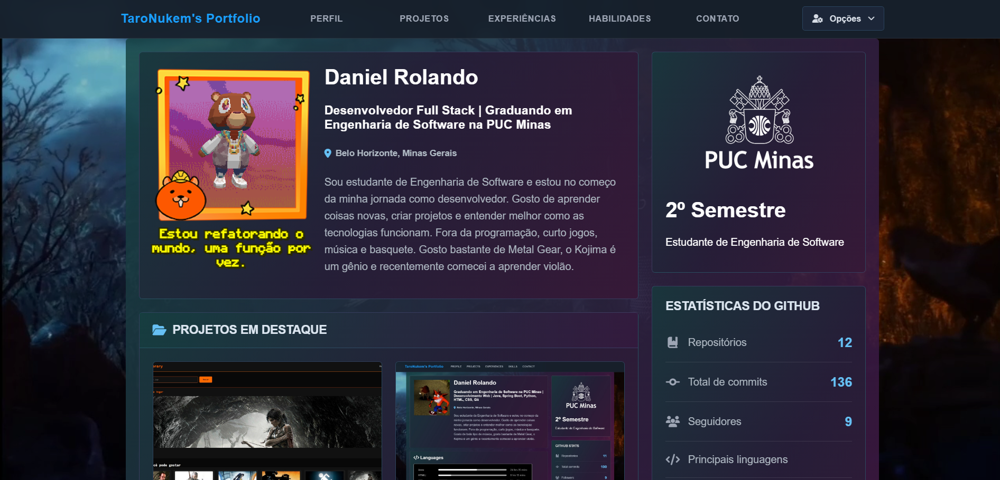
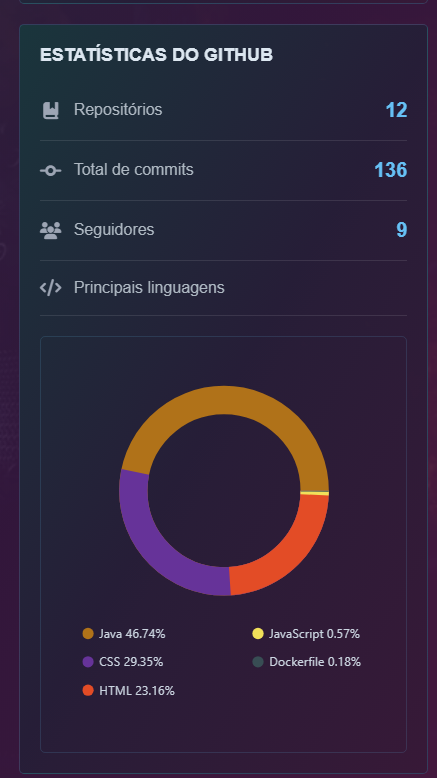
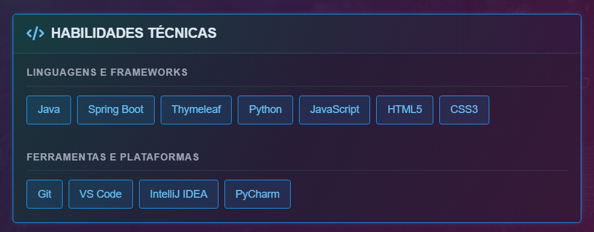

# Portfólio Pessoal — Daniel Rolando

Portfólio pessoal desenvolvido com **Java** e **Spring Boot** para apresentar minha trajetória acadêmica, minhas habilidades e meus projetos na área de tecnologia. A aplicação integra serviços externos para exibir informações do GitHub, estatísticas de programação do WakaTime e um formulário de contato com envio de e-mail.

🔗 **Demonstração:** [portifolio-r27e.onrender.com](https://portifolio-r27e.onrender.com/)

> O site está hospedado no plano gratuito do Render, então o primeiro acesso pode demorar alguns segundos enquanto o servidor "acorda".

## Funcionalidades

- Apresentação pessoal e acadêmica.
- Exibição de habilidades e informações profissionais.
- Integração com a API do GitHub para obter informações do perfil.
- Estatísticas de programação com a API do WakaTime.
- Resumo das linguagens de programação utilizadas.
- Formulário de contato em modal, com envio de e-mail via Resend.
- Disponibilização do currículo para consulta.
- Suporte a português e inglês, com troca de idioma sem recarregar a página.
- Interface personalizada com recursos visuais, imagens e vídeo de fundo.

## Capturas de tela

### Página inicial



### Estatísticas e informações




## Tecnologias utilizadas

| Tecnologia | Utilização |
|---|---|
| Java | Linguagem principal |
| Spring Boot | Estrutura da aplicação web |
| Thymeleaf | Renderização das páginas HTML |
| HTML5 e CSS3 | Estrutura, estilização e layout |
| JavaScript | Recursos interativos (modais, menu, troca de idioma, formulário) |
| Maven | Gerenciamento de dependências e execução do projeto |
| GitHub API | Consulta de informações do perfil |
| WakaTime API | Consulta de estatísticas de programação |
| Resend | Envio de e-mails do formulário de contato |
| Render | Hospedagem e deploy |
| Git e GitHub | Versionamento e hospedagem do código |

## Estrutura do projeto

```text
daniel/
├── src/
│   ├── main/
│   │   ├── java/com/portifolio/daniel/
│   │   │   ├── config/
│   │   │   │   └── LocaleConfig.java
│   │   │   ├── controllers/
│   │   │   │   └── DanielController.java
│   │   │   ├── model/
│   │   │   │   ├── GitHubUser.java
│   │   │   │   └── WakaTimeResumo.java
│   │   │   ├── service/
│   │   │   │   ├── EmailService.java
│   │   │   │   ├── GitHubService.java
│   │   │   │   └── WakaTimeService.java
│   │   │   └── DanielApplication.java
│   │   └── resources/
│   │       ├── languages/
│   │       │   ├── messages.properties
│   │       │   └── messages_en.properties
│   │       ├── static/
│   │       │   ├── css/
│   │       │   ├── files/
│   │       │   ├── images/
│   │       │   └── videos/
│   │       ├── templates/
│   │       │   └── index.html
│   │       └── application.properties
│   └── test/
├── docs/
│   └── screenshots/
├── .mvn/
├── mvnw
├── mvnw.cmd
├── pom.xml
└── README.md
```

## Como executar o projeto

### Pré-requisitos

- Java na versão configurada no `pom.xml`.
- Git.
- Acesso à internet para consultar as APIs externas.
- Chaves de API do WakaTime e do Resend (e, opcionalmente, um token do GitHub).

### 1. Clone o repositório

```bash
git clone https://github.com/TaroNukem/Portifolio.git
cd Portifolio
```

### 2. Configure as variáveis de ambiente

A aplicação lê as credenciais de variáveis de ambiente. **Nunca** coloque chaves direto no código ou no repositório.

| Variável | Descrição |
|---|---|
| `RESEND_API_KEY` | Chave da API do Resend, usada no envio do formulário de contato |
| `WAKATIME_API_KEY` | Chave da API do WakaTime |
| `GITHUB_TOKEN` | Token do GitHub (opcional, evita limite de requisições) |

No Windows (PowerShell):

```powershell
$env:RESEND_API_KEY="sua_chave"
$env:WAKATIME_API_KEY="sua_chave"
```

No Linux ou macOS:

```bash
export RESEND_API_KEY="sua_chave"
export WAKATIME_API_KEY="sua_chave"
```

### 3. Execute a aplicação

No Windows:

```powershell
.\mvnw.cmd spring-boot:run
```

No Linux ou macOS:

```bash
./mvnw spring-boot:run
```

### 4. Acesse o portfólio

```text
http://localhost:8080
```

## Deploy

O projeto é publicado no [Render](https://render.com) como Web Service. As mesmas variáveis de ambiente da seção anterior são cadastradas na aba **Environment** do serviço.

## Objetivos do projeto

- Aplicar conhecimentos de desenvolvimento web com Java e Spring Boot.
- Organizar uma aplicação em controllers, models e services.
- Trabalhar com APIs externas e consumo de dados.
- Implementar internacionalização de conteúdo.
- Desenvolver e aprimorar uma interface web personalizada.
- Apresentar meus projetos e acompanhar minha evolução como desenvolvedor.

## Autor

**Daniel Rolando**

Graduando em Engenharia de Software na PUC Minas.

- GitHub: [@TaroNukem](https://github.com/TaroNukem)

## Licença

Este projeto foi desenvolvido para fins de aprendizado e apresentação pessoal.