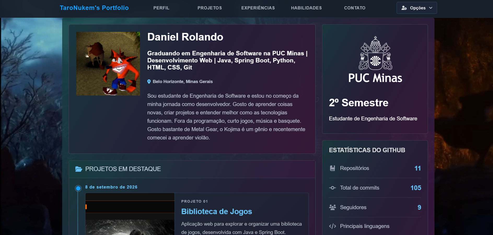
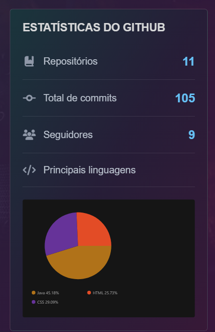
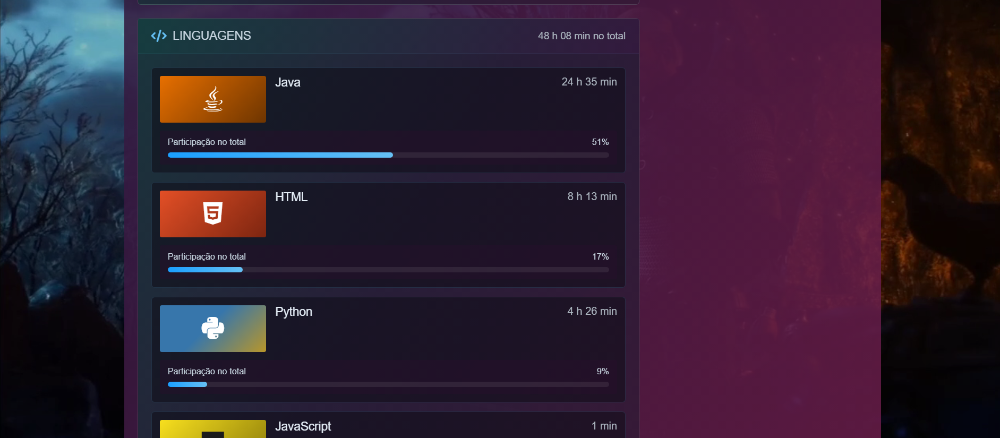

# Portfólio Pessoal — Daniel Rolando

Portfólio pessoal desenvolvido com Java e Spring Boot para apresentar minha trajetória acadêmica, minhas habilidades e meus projetos na área de tecnologia. O projeto também integra serviços externos para exibir informações do GitHub e estatísticas de programação do WakaTime.

## Demonstração

- **GitHub:** [TaroNukem](https://github.com/TaroNukem)

https://portifolio-r27e.onrender.com/

## Funcionalidades

- Apresentação pessoal e acadêmica.
- Exibição de habilidades e informações profissionais.
- Integração com a API do GitHub para obter informações do perfil.
- Exibição de estatísticas de programação utilizando a API do WakaTime.
- Resumo das linguagens de programação utilizadas.
- Disponibilização do currículo para consulta.
- Suporte a português e inglês.
- Interface personalizada com recursos visuais, imagens e vídeo de fundo.

## Tecnologias utilizadas

| Tecnologia | Utilização |
|---|---|
| Java | Linguagem principal |
| Spring Boot | Estrutura da aplicação web |
| Thymeleaf | Renderização das páginas HTML |
| HTML5 | Estrutura das páginas |
| CSS3 | Estilização e layout |
| JavaScript | Recursos interativos da interface |
| Git e GitHub | Versionamento e hospedagem do código |
| GitHub API | Consulta de informações do perfil |
| WakaTime API | Consulta de estatísticas de programação |
| Maven | Gerenciamento de dependências e execução do projeto |

## Estrutura do projeto

```text
daniel/
├── src/
│   ├── main/
│   │   ├── java/com/portifolio/daniel/
│   │   │   ├── config/
│   │   │   │   └── LocaleConfig.java
│   │   │   ├── controllers/
│   │   │   │   └── DanielController.java
│   │   │   ├── model/
│   │   │   │   ├── GitHubUser.java
│   │   │   │   └── WakaTimeResumo.java
│   │   │   ├── service/
│   │   │   │   ├── GitHubService.java
│   │   │   │   └── WakaTimeService.java
│   │   │   └── DanielApplication.java
│   │   └── resources/
│   │       ├── languages/
│   │       │   ├── messages.properties
│   │       │   └── messages_en.properties
│   │       ├── static/
│   │       │   ├── css/
│   │       │   ├── files/
│   │       │   ├── images/
│   │       │   └── videos/
│   │       ├── templates/
│   │       │   └── index.html
│   │       └── application.properties
│   └── test/
├── .mvn/
├── mvnw
├── mvnw.cmd
├── pom.xml
└── README.md
```

## Como executar o projeto

### Pré-requisitos

- Java compatível com a versão configurada no projeto.
- Git.
- Acesso à internet para consultar as APIs externas.

### 1. Clone o repositório

```bash
git clone https://github.com/TaroNukem/Portifolio.git
```

### 2. Entre na pasta do projeto

```bash
cd Portifolio
```

### 3. Configure as credenciais

Configure as credenciais necessárias para as integrações com o GitHub e o WakaTime conforme as propriedades utilizadas pela aplicação.

Mantenha chaves de API e outros dados sensíveis em configurações locais ou variáveis de ambiente. Não publique essas credenciais no repositório.

### 4. Execute a aplicação

No Windows, utilizando o Maven Wrapper:

```powershell
.\mvnw.cmd spring-boot:run
```

No Linux ou macOS:

```bash
./mvnw spring-boot:run
```

### 5. Acesse o portfólio

Abra o navegador e acesse:

```text
http://localhost:8080
```

## Capturas de tela

<!-- Adicione capturas reais da interface nesta seção. -->

### Página inicial



### Estatísticas e informações




## Objetivos do projeto

- Aplicar conhecimentos de desenvolvimento web com Java e Spring Boot.
- Praticar a organização de uma aplicação utilizando controllers, models e services.
- Trabalhar com APIs externas e consumo de dados.
- Implementar internacionalização de conteúdo.
- Desenvolver e aprimorar uma interface web personalizada.
- Apresentar meus projetos e acompanhar minha evolução como desenvolvedor.

## Autor

**Daniel Rolando**

Graduando em Engenharia de Software na PUC Minas.

- GitHub: [@TaroNukem](https://github.com/TaroNukem)

## Licença

Este projeto foi desenvolvido para fins de aprendizado e apresentação pessoal.